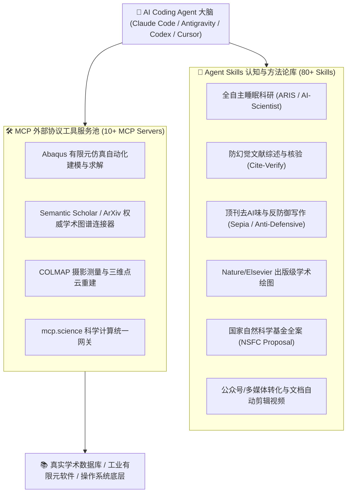

# 🚀 Skills & MCP Repository · 实用科研 Skills 与 MCP 超级工具库

<div align="center">

**面向科学研究、学术论文撰写、工程有限元仿真、基金申报与成果转化的 AI Agent 全套技能与 MCP 服务生态**

*A Comprehensive Suite of AI Agent Skills and Model Context Protocol (MCP) Servers for Scientific Research, Academic Writing, Finite Element Simulation, Grant Proposals, and Multimedia Dissemination.*

---

[](https://github.com/Marvin-LiJunZan/skills-mcp)
[](https://gitee.com/LiJunZan/skills-mcp)
[](LICENSE)
[](#-技能全景分类--skill-catalog)
[](#-mcp-服务矩阵--mcp-servers)
[](#-支持的-agent-平台--supported-agents)

**[English](#-english)** | **[简体中文](#-简体中文)**

</div>

---

## 📖 目录 / Table of Contents

- [简体中文](#-简体中文)
  - [项目愿景与定位](#-项目愿景与定位)
  - [核心架构：双轮驱动](#-核心架构双轮驱动)
  - [技能全景分类 (Skill Catalog)](#-技能全景分类--skill-catalog)
  - [MCP 服务矩阵 (MCP Servers)](#-mcp-服务矩阵--mcp-servers)
  - [快速上手 (Quick Start)](#-快速上手--quick-start)
- [English](#-english)
  - [Vision & Positioning](#-vision--positioning)
  - [Dual-Engine Architecture](#-dual-engine-architecture)
  - [Key Capabilities Overview](#-key-capabilities-overview)
  - [Quick Start Guide](#-quick-start-guide)
- [支持的 Agent 平台 / Supported Agents](#-支持的-agent-平台--supported-agents)
- [仓库目录结构 / Repository Structure](#-仓库目录结构--repository-structure)
- [致谢与开源许可 / License](#-致谢与开源许可--license)

---

# 🇨🇳 简体中文

## 🌟 项目愿景与定位

通用大语言模型（如 Claude、GPT-4、Gemini、DeepSeek 等）在通识对话和简单代码编写上表现优异，但在**深度科学研究、严苛学术出版、工业工程仿真与合规科技管理**中，常常面临四大痛点：
1. **学术表达“AI 味”浓厚、语气防御畏缩**，缺乏顶级学者的自信与递进逻辑；
2. **文献检索易产生幻觉**，引文容易出现年份错漏、虚构论文或断章取义；
3. **无法连接专业工程软件**，如有限元仿真软件 Abaqus、COLMAP 点云重建，只能写“玩具代码”；
4. **长上下文遗忘与跨工具割裂**，从课题选题、数据分析、代码实验到成稿发刊无法形成自洽证据链。

**`skills-mcp` 项目正是为破解上述痛点而生的“专家级 AI Agent 增强底座”。**
它聚合了 **80+ 专业领域 Agent Skills** 以及 **10+ Model Context Protocol (MCP) 服务**，赋予 AI 智能体顶刊审稿专家的思维体系、研究员的实证严谨度、以及操作专业物理/工程软件的行动力。

---

## 🏗️ 核心架构：双轮驱动

本仓库遵循 **“认知方法论（Skills） + 现实物理交互（MCP）”** 的协同设计：



---

## 🎯 技能全景分类 / Skill Catalog

本项目将 80+ 个高质量技能按实际科研与工业流程划分为八大模块：

### 1. 🔬 全自主科研与闭环实验 (Autonomous Research & Experimentation)
* **`auto-research-in-sleep` (ARIS)**: 端到端全自主科研工作流，支持无人值守探索、代码生成、实验桥接与报告合成。
* **`AI-Scientist` & `AI-Scientist-v2`**: 整合 Sakana AI 自动化科学家框架，从 Idea 提出、文献调研、实验设计到撰写初稿一气呵成。
* **`AgentLaboratory`**: 自主科学研究协同实验室，多 Agent 扮演 PI、博士后、初级研究员协同攻关。
* **`karpathy-autoresearch`**: 基于极简心智模型的自主研究迭代循环。
* **`autora`**: 经验法则与科学规律自动化探索框架。
* **`research-workflow` & `research-project-template`**: 规范化的计算科研证据链闭环工程模板（`claim → method → data → code → result → figure → manuscript`）。
* **`tabular-ml-master`**: 生产级表格机器学习大师工作流（LightGBM, XGBoost, CatBoost, TabPFN, AutoGluon, Optuna, SHAP 解释）。

### 2. 📚 文献深度挖掘、RAG 与防幻觉核验 (Literature & Citation Verification)
* **`ccc-literature-scout`**: 自动化大规模学术文献雷达，跨 25+ 权威数据库自动化检索、全摘要提取、BibTeX 去重与矩阵综合。
* **`Deep-Research-skills`**: 针对复杂主题的深度学术证据调研与综述报告生成。
* **`cite-verify` / `reference-checker`**: 严格核验引文真实性、DOI 有效性、发表年份与引证因果逻辑，彻底粉碎“AI 虚构文献”。
* **`paper-rag` / `PaperNotes` / `PaperPilot-skills`**: 本地论文库向量 RAG 检索、精准段落溯源与精读笔记整理。
* **`stanford-storm`**: 基于斯坦福 STORM 知识检索与长篇结构化综述自动化构建体系。
* **`arxiv-digest` / `survey-builder`**: 每日最新预印本雷达监控与领域综述生成器。

### 3. ✍️ 顶级学术论文写作、去“AI味”与高保真排版 (Manuscript & De-AI)
* **`anti-defensive-writing`**: 破除学术“防御性写作”，消除过度免责、心虚词汇与流水账叙事，建立自信有力的顶刊成果发布会式论述。
* **`human-writing` / `humanizer` / `humanizer-zh` / `sepia`**: 深度清洗 "delve into", "pave the way", "vital role" 等高频 AI 套话，还原地道英语与母语级学者表达。
* **`PaperSpine`**: 论文逻辑脊椎骨架构建，确保从 Abstract 到 Conclusion 全文因果闭环。
* **`supervisor-skills`**:
  * `tech-paper-template`: 工科/计算机领域技术论文 6 步黄金思考模板。
  * `benchmark-paper-template`: 评测与 Benchmark 论文 5 支柱构建框架。
  * `intro-drafter`: 顶刊 Introduction 6 段式渐进论述生成器。
  * `idea-evaluator`: 五维度（更高、更快、更强、更省、更广）审稿人视角科研创意评估。
* **`nature-skills` & `ccc-author-guide`**: Nature / Elsevier CCC 期刊权威投稿指南与技术合规审查清单。
* **`latex-document-skill`**: 专业 LaTeX 宏包协调、公式美化与编译报错自动排查修复。
* **`tex-to-word-converter`**: 高保真 LaTeX 转换 Word（.docx），精准保留三线表、矢量公式与动态交叉引用。
* **`ccc-paper-converter`**: 借助 GPU 多引擎（MinerU / Docling）将 PDF 论文逆向解析为带公式与表格的高保真 Markdown。

### 4. 📊 出版级学术图表设计与可视化 (Scientific Visualization)
* **`academic-figure-skill` / `nature-figure`**: 严格遵循 Nature / Science 规范的多面板复合矢量图（PDF/SVG/600+ DPI TIFF）生成。
* **`ccc-academic-figure-style`**: 蓝金/红蓝学术配色、白心柱状图、3D 体素一致性配色方案规范。
* **`scipilot-figure-skill`**: 图表严谨性自检（色盲友好度、防误导双Y轴拦截、离群值真实分布呈现）。
* **`mermaid-charts` / `roughjs-design`**: 交互式流程图、概念手绘草图与系统架构图生成。

### 5. 🏛️ 国家基金申报与企业研发管理 (Grant Writing & R&D Management)
* **`nsfc-proposal`**: 2026 最新国家自然科学基金全流程申报工作流（青年/面上/优青/杰青）。
* **`fund-background-writer` / `fund-literature-review-writer`**: 立项依据、战略需求与国内外研究现状文献评述撰写。
* **`fund-research-content-writer` / `fund-technical-route-writer`**: 关键科学问题凝练、技术路线图设计与创新特色提炼。
* **`k2f` / `k2f-grant-proposal`**: 面向国际顶级科研基金（NIH / NSF / DARPA）的高说服力提案引擎。
* **`engineering-grant-reporting`**: 央企重大工程研发科技项目申报、中期检查、结题验收及十卷册合规审查系统。
* **`rd-attendance-salary-allocator` / `rd-multisource-payroll-allocator`**: 研发费用加计扣除考勤工时率与职工薪酬合规分摊系统。
* **`scan-project-merger`**: 工程研发档案扫描件批量旋转、校正与目录化智能合并。

### 6. ⚙️ 工业仿真、三维视觉与量化分析 (Engineering & Quant)
* **`abaqus-mcp` / `abaqus-mcp-server`**: Abaqus 脚本自动化建模、材料本构定义、网格划分、作业提交与应力场数据提取。
* **`colmap-4.0.3`**: 运动恢复结构（SfM）与高精度三维点云稠密重建。
* **`quant-trading-skills`**: 经典量化与算法交易专家系统（石川《因子投资》、Chan《量化交易》、丁鹏《量化投资》核心方法论）。
* **`industry-trend-score-skill` / `thsfund` / `hithink-finance`**: 同花顺行业趋势打分、基金轮动策略与财务数据透视。

### 7. 🎬 多媒体转化、微信公众号矩阵与文档自动化剪辑 (Media & Dissemination)
* **微信公众号全案生产套件 (Baoyu Suite & Local)**:
  * `baoyu-markdown-to-html`: Markdown 转换为符合微信公众号规则的内联样式 HTML，普通外链自动转底部引用。
  * `baoyu-post-to-wechat`: 通过官方 API 或 Chrome CDP 自动化推送内容至公众号草稿箱。
  * `baoyu-article-illustrator` / `baoyu-infographic`: 文章智能配图与 21 种版式的高密度知识信息大图。
  * `baoyu-xhs-images`: 一键生成小红书/微信图文卡片。
  * `微信公众号运营` (`wechat-oa-weizhu`): 8 选 1 爆款标题、文风硬规则、蓝金 HTML 无头渲染配图模板。
* **文档自动视频生成与剪辑 (HyperFrames & Local)**:
  * `product-launch-video`: 根据软件使用文档、README 或产品功能自动生成 Remotion 代码级产品演示短视频。
  * `ai-video-producer`: 教程文档提炼 → TTS 声音克隆配音 → 录屏素材对齐 → Whisper 自动打轴压制视频。
  * `remotion-to-hyperframes` / `general-video`: Remotion 动画视频转换与自由镜头混剪。

### 8. 🧰 Agent 生态增强与跨平台协作 (Meta-Skills & Orchestration)
* **`find-skills`**: Vercel 官方技能发现与安装包管理器（对接 [skills.sh](https://skills.sh/)，支持对话中自主发现与安装新工具）。
* **`grill-me` / `grill-with-docs` / `grilling`**: 模拟严苛的学术评审专家，对设计方案进行连环追问与边界压力测试。
* **`handoff` / `claude-handoff`**: 跨会话上下文无缝交接，防长上下文衰退与断点续传。
* **`paper-ppt` / `ppt-master` / `guizang-ppt-skill`**: 学术论文一键抽取图表，生成 6–10 页高质学术答辩/组会 PPT。
* **`patent-disclosure-skill`**: 将技术成果创新点一键转换为标准专利交底书。

---

## 🔌 MCP 服务矩阵 / MCP Servers

位于 `mcp/` 目录下，提供可以直接接入大模型的标准化协议服务：

| 服务名称 | 核心协议与工具 | 主要功能 |
| :--- | :--- | :--- |
| **`abaqus-mcp`** | FastMCP / Python stdio | 自动化编写并执行 Abaqus CAE 脚本，控制建模、载荷求解与后处理应力提取 |
| **`semantic-scholar-mcp`** | FastMCP / HTTP API | 实时检索全球学术文献、引用网络图谱、作者 h-index 与学术影响力分析 |
| **`arxiv-mcp-server`** | stdio | 检索 ArXiv 每日最新论文，抓取元数据、分类、摘要与 PDF 链接 |
| **`academic-search-mcp-server`** | FastMCP | 聚合 Crossref、OpenAlex 等学术检索端点 |
| **`research-papers-mcp-server`** | stdio | 统一管理本地研究论文数据库与结构化文献缓存 |
| **`colmap-4.0.3`** | CLI Wrapper | 执行高精度摄影测量三维特征提取、特征匹配与稀疏/稠密三维重建 |
| **`mcp.science`** | API Gateway | 科学计算与生物/分子/化学结构分析工具网关 |

---

## ⚡ 快速上手 / Quick Start

### 💡 极速安装（推荐）：直接把下面这段话发给你的 AI 助手！

如果你正在使用 **Claude Code、Google Antigravity、Cursor、Codex、Cline 或 Windsurf**，无需手动执行繁琐的终端命令，**直接复制以下 Prompt 发送给它**，AI 助手会自动完成克隆、软链接挂载与 MCP 服务配置：

```markdown
请帮我安装并配置开源科研技能与 MCP 仓库 [skills-mcp]：
1. 请在本地合适路径克隆本仓库：
   git clone https://github.com/Marvin-LiJunZan/skills-mcp.git
   （若国内网络访问受限，请使用 Gitee 镜像：git clone https://gitee.com/LiJunZan/skills-mcp.git）
2. 识别你当前所处的 AI 智能体环境（如 Claude Code 的 ~/.claude/skills/、Antigravity 的 ~/.gemini/config/skills/、或当前工作区的技能目录），将 skills-mcp/skills 目录中的常用科研/写作/绘图技能创建软链接（Windows Junction 或 Linux/macOS ln -s）或复制过去激活。
3. 检查并在当前 Agent 的 MCP 配置文件中添加 skills-mcp/mcp/ 下的关键服务（如 semantic-scholar、abaqus 等）。
4. 全部配置完成后，列出你已成功激活的 Skills 与 MCP 工具清单告诉我。
```

---

### 🛠️ 手动安装流程（开发者自选）

#### 1. 克隆本仓库
```bash
# GitHub
git clone https://github.com/Marvin-LiJunZan/skills-mcp.git

# Gitee（国内镜像加速）
git clone https://gitee.com/LiJunZan/skills-mcp.git
```

#### 2. 在 AI Agent 中直接使用 Skills
现代 AI Agent 均原生支持 `SKILL.md` 规范：

* **方式 A：通过 `find-skills` 动态安装 / 管理**
  ```bash
  # 搜索技能
  npx skills find research
  
  # 安装技能至全局或当前项目
  npx skills add vercel-labs/skills --skill find-skills -y
  ```

* **方式 B：直接软链接至你的 Agent 配置目录**
  * **Antigravity / Gemini CLI**: 链接至 `~/.gemini/config/skills/`
  * **Claude Code**: 链接至 `~/.claude/skills/`
  * **Cursor**: 引用对应技能目录下的 `.md` 作为 Rules/Context。

#### 3. 配置与启动 MCP 服务
以配置 `abaqus-mcp` 与 `semantic-scholar-mcp` 为例，在你的 Agent 配置文件（如 `claude_desktop_config.json` 或 Antigravity MCP 配置）中添加：

```json
{
  "mcpServers": {
    "semantic-scholar": {
      "command": "python",
      "args": ["<path-to-repo>/mcp/semantic-scholar-mcp/server.py"]
    },
    "abaqus": {
      "command": "python",
      "args": ["<path-to-repo>/mcp/abaqus-mcp/server.py"]
    }
  }
}
```

---

# 🌐 English

## 🎯 Vision & Positioning

While mainstream LLMs perform well in daily conversations and general programming, they struggle in **rigorous academic research, high-impact scientific publications, and heavy industrial simulation**:
1. **Academic "AI Flavour" & Timid Prose**: Pervasive use of defensive phrases, passive clichés, and lack of assertiveness.
2. **Hallucinated Citations**: Fabricated paper titles, wrong publication years, or invalid DOIs.
3. **Disconnection from Engineering Toolchains**: Inability to interact directly with industrial FEA engines (Abaqus) or 3D photogrammetry pipelines (COLMAP).
4. **Context Degradation**: Fragmented stages from hypothesis formulation to peer-reviewed code and paper delivery.

**`skills-mcp` is designed as an industrial-grade foundational suite for AI Agents.**
It unifies **80+ specialized Agent Skills** and **10+ Model Context Protocol (MCP) servers**, equipping AI agents with the mental models of seasoned principal investigators (PIs), the visual aesthetics of Nature/Science editors, and the practical capabilities to command engineering software.

---

## 🏛️ Dual-Engine Architecture

```
                  ┌─────────────────────────────────────┐
                  │          AI Coding Agent            │
                  │  (Claude Code / Antigravity / Cursor)│
                  └──────────────────┬──────────────────┘
                                     │
           ┌─────────────────────────┴─────────────────────────┐
           ▼                                                   ▼
┌──────────────────────────────────────┐    ┌──────────────────────────────────────┐
│        Skills Layer (80+)            │    │         MCP Server Layer (10+)       │
│  - Methodology & Rigorous Standards  │    │  - Real-World Protocol Interfaces    │
│  - Anti-Defensive & De-AI Writing    │    │  - Abaqus FEA Automated Modeling     │
│  - Reproducible Evidence Workflow    │    │  - Semantic Scholar & ArXiv Graphs   │
│  - Grant Proposals (NSFC & NIH/NSF)  │    │  - COLMAP 3D Photogrammetry          │
└──────────────────────────────────────┘    └──────────────────────────────────────┘
```

---

## 📦 Key Capabilities Overview

1. **Autonomous Research Loop**:
   - `auto-research-in-sleep` (ARIS), `AI-Scientist`, `AgentLaboratory`, `karpathy-autoresearch`, and `tabular-ml-master`.
2. **Anti-Hallucination & Literature Verification**:
   - `cite-verify`, `reference-checker`, `ccc-literature-scout`, `Deep-Research-skills`, and `stanford-storm`.
3. **Publication-Grade Writing & Humanization**:
   - `anti-defensive-writing` (eliminating defensive tone), `human-writing`, `sepia`, `PaperSpine`, `nature-skills`, `latex-document-skill`, and `tex-to-word-converter`.
4. **Scientific Visualization**:
   - `academic-figure-skill`, `nature-figure`, and `ccc-academic-figure-style` (white-center bar charts, red-blue heatmaps, 3D volumetric consistency).
5. **National Grants & Enterprise R&D**:
   - `nsfc-proposal` (2026 Chinese National Natural Science Foundation), `k2f` (NIH/NSF), `engineering-grant-reporting`, and `rd-attendance-salary-allocator`.
6. **Industrial Simulation & Quantitative Finance**:
   - `abaqus-mcp` (Finite Element Analysis automation), `colmap-4.0.3` (3D point cloud reconstruction), and `quant-trading-skills`.
7. **Multimedia & Automated Video Editing**:
   - `baoyu-skills` (WeChat Official Account full-pipeline publishing, infographics, and cards) and `product-launch-video` / `ai-video-producer` (generating Remotion & TTS video tutorials directly from documentation).
8. **Agent Collaboration & Meta-Skills**:
   - `find-skills` (dynamic skill discovery via skills.sh), `grill-me` (relentless design tree stress-testing), and `handoff` (lossless cross-session context transition).

---

## 🚀 Quick Start Guide

### 💡 One-Click Setup with your AI Assistant (Recommended)

If you are using **Claude Code, Google Antigravity, Cursor, Codex, Cline, or Windsurf**, there is no need to manually run commands. Simply **copy and paste the prompt below to your AI assistant**:

```markdown
Please help me set up and configure the open-source [skills-mcp] research toolkit:
1. Clone the repository to a suitable local directory:
   git clone https://github.com/Marvin-LiJunZan/skills-mcp.git
   (Or use the Gitee mirror if GitHub is slow: git clone https://gitee.com/LiJunZan/skills-mcp.git)
2. Detect your current AI agent environment (e.g., ~/.claude/skills/ for Claude Code, ~/.gemini/config/skills/ for Antigravity, or the workspace skill directory), and symlink (or copy) the relevant skills from skills-mcp/skills to activate them.
3. Inspect and configure the essential MCP servers under skills-mcp/mcp/ (such as semantic-scholar and abaqus) into your agent's MCP configuration file.
4. Report back with the list of successfully activated Skills and MCP servers.
```

---

### 🛠️ Manual Installation (Optional)

```bash
# Clone the repository
git clone https://github.com/Marvin-LiJunZan/skills-mcp.git

# Or via Gitee (Fast mirror for mainland China)
git clone https://gitee.com/LiJunZan/skills-mcp.git
```

### Dynamic Skill Discovery via `find-skills`
```bash
# Search for skills interactively
npx skills find research

# Install a skill package
npx skills add vercel-labs/skills --skill find-skills -y
```

---

## 💻 支持的 Agent 平台 / Supported Agents

| 智能体平台 (Agent) | 兼容性 (Compatibility) | 推荐接入方式 (Integration Method) |
| :--- | :---: | :--- |
| **Google Antigravity** | 💯 原生全面支持 | 自动加载工作区 `skills/` 或软链至 `~/.gemini/config/skills/` |
| **Anthropic Claude Code** | 💯 原生全面支持 | 软链至 `~/.claude/skills/`，MCP 配置于 `claude_desktop_config.json` |
| **OpenAI Codex CLI** | 💯 原生全面支持 | 放入工作区或由 `npx skills` 自动同步 |
| **Cursor / Windsurf** | 🌟 完全支持 | 引入 `.cursorrules` / System Prompt 或通过 Skills 模式触发 |
| **OpenClaw / AgentLab** | 🌟 完全支持 | 标准 Python / CLI 执行环境直接调用 |

---

## 📂 仓库目录结构 / Repository Structure

```text
skills-mcp/
├── skills/                     # 80+ 模块化 Agent Skills 目录
│   ├── anti-defensive-writing/ # 顶级期刊反防御性写作与去 AI 味
│   ├── auto-research-in-sleep/ # ARIS 睡眠自主实验与科研闭环
│   ├── abaqus-mcp/             # Abaqus 有限元仿真技能
│   ├── baoyu-*/                # 宝玉微信排版、发布、信息图与插画矩阵
│   ├── ccc-*/                  # CCC 土木与材料权威期刊投稿全套套件
│   ├── nsfc-proposal/          # 国家自然科学基金申报全模块工作流
│   ├── product-launch-video/   # 文档自动生成 Remotion 产品演示视频
│   ├── quant-trading-skills/   # 现代量化投资与多因子算法交易体系
│   ├── tabular-ml-master/      # 表格机器学习生产级大师技能
│   └── ...                     # 其余数十个细分领域技能
├── mcp/                        # 10+ Model Context Protocol 服务实现
│   ├── abaqus-mcp/             # Abaqus 脚本执行与有限元分析 MCP
│   ├── semantic-scholar-mcp/   # 权威学术图谱连接器
│   ├── arxiv-mcp-server/       # ArXiv 论文抓取服务器
│   ├── colmap-4.0.3/           # 三维摄影测量重建核心
│   └── ...
├── research-workflow/          # 证据链闭环科研工作流规范标准
├── research-project-template/  # 标准化科研工程项目起步模板
├── .agents/                    # Agent 环境注册与本地同步缓存
└── README.md                   # 本说明文档（中英双语）
```

---

## 📜 致谢与开源许可 / License

* 本项目核心框架与聚合代码基于 [MIT License](LICENSE) 开源。
* 部分集成的子模块（如 Sakana AI `AI-Scientist`、Vercel `find-skills`、宝玉 `baoyu-skills`、HeyGen `hyperframes` 等）版权属于各原作者，请在使用时遵守各自对应的开源协议。

---

<div align="center">

**Built with ❤️ for global researchers, engineers, and AI developers.**

*Created & Curated by [Junzan Li (Marvin-LiJunZan)](https://github.com/Marvin-LiJunZan)*

⭐ 如果这个项目对你的科研、工程或工作有所帮助，欢迎在 GitHub / Gitee 点个 Star 支持！

</div>
