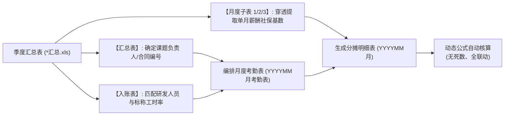

# 研发费用人工费考勤表与职工薪酬分摊表标准化作业规程 (SOP)

**文件编号**：`SOP-RD-FIN-002`  
**版本编号**：`V1.0 (正式生效版)`  
**编制人**：陈前，李俊赞  
**适用范围**：科技攻关项目、工程横向研发课题、央企科技计划（中铁建华南建设各在研课题）研发人员人工费用核算、月度考勤编排、薪酬分摊明细表编制、企业研发费用加计扣除申报及科技研发“十卷册”归档。

---

## 一、 规程概述与适用范围

### 1.1 编制目的
规范科技研发课题人工费用的分摊核算及考勤管理工作，确保研发人员月度工时、薪酬分配表与企业真实财务辅助账、个税申报表、高企认定十卷册（第 03 卷人员编制、第 04 卷费用分配、第 05 卷辅助账）之间保持**穿透式、零差错的多维勾稽一致**，彻底杜绝手工编报中的列名错位、跨期断档与死数硬编码隐患。

### 1.2 编制依据
* 《企业会计准则第 6 号——无形资产》（研发支出资本化与费用化归集）
* 《国家税务总局关于研发费用税前加计扣除归集范围有关问题的公告》
* 集团工程科技研发计划项目管理办法与“十卷册”科技档案合规归档指引
* 基准交付样板：`2024年1-3月研发人员薪酬、职工薪酬分配表21-B-02（修改定稿打印版）.xlsx`

---

## 二、 核心核算原则与四大勾稽铁律



### 2.1 铁律一：考勤周期严格固定为“上月 21 日至当月 20 日”
各月份考勤统计区间并非自然月首末，而是**从上个月 21 日算至当月 20 日**（例如：2024 年 1 月研发考勤周期为 2023-12-21 至 2024-01-20；2024 年 2 月为 2024-01-21 至 2024-02-20；2024 年 3 月为 2024-02-21 至 2024-03-20）。每期实际列数由当期日历天数（28 至 31 天）动态决定。

### 2.2 铁律二：多课题兼任工时率总和严禁超限（$\sum \text{工时率} \le 100\%$）
科研骨干往往同时承担或参与多个研发课题（例如陈前同时担任 `21-B-02` 与 `19-B-03` 负责人，并在多个装备课题中参研）。单人在所有在研课题中的**月度工时率总和必须 $\le 1.0$**（剩余比例留作日常工程管理工时），各课题分摊表独立列账，严禁重复计列研发工时。

### 2.3 铁律三：薪酬社保基数必须“穿透提取单月真实发生数”
* ❌ **常见错误**：直接将《职工薪酬分配表入账》中的金额当做单月基数（该表中的数值是整个季度的 3 个月合计数）；
* ✅ **标准操作**：应发工资、五险社保及公积金基数，**必须从该季度汇总表下属的月度独立子表（Sheet `1`/`2`/`3` 或 `4月`/`5月`/`6月` 或 `10月份薪酬`）中逐月按姓名对位提取**。

### 2.4 铁律四：全部关联数据采用活公式，严禁硬编码死数
分摊明细表中的“从事研发天数”与“工时率”必须以跨表公式引用对应考勤表；右侧各研发费用分项必须以公式（`=基数 * $D5`）联动计算；小计与合计必须以 `=SUM(...)` 汇总，确保考勤打点微调时金额实时联动。

### 2.5 业务排班与工时拼凑五大核心准则 (Codex 规范)
1. **春节放假口径（公司级特殊规定）**：
   - **除夕至正月初十（含两端）全员放假**。
   - **优先级**：公司假期绝对优先于国家法定的周末调休上班。例如 2024年2月9日至19日全员放假（含2月18日周日调休也休），春节休假落在 2 月考勤周期（1月21日～2月20日）内。
2. **科研单日工时面额限定（凑工时规则）**：
   - 科研单日工时严禁随意填写非标准小时，限定只能由 **`8`、`4`、`2`、`1`、`0.5`** 这 5 个标准面额拆分拼凑（如 19 小时拆解为 $8+8+2+1$，6.5 小时拆解为 $4+2+0.5$）。
3. **团队排班跟随课题负责人（领导）**：
   - **领导优先排定**：首先依据课题负责人工时排定其科研日期。
   - **组员高度对齐**：项目组成员的科研日期优先在课题负责人的科研日内选择，确保团队科研行为的真实性与合规性（重合率 $\ge 80\%$，每人最多允许 1 天例外）。
4. **科研天数纯正公式与两位小数保留（对齐修改定稿版）**：
   - 考勤表科研天数采用原始纯正公式 `=SUM(D6:AH6)/8`（**不带强制四舍五入 ROUND**，杜绝工时失真）。
   - 单元格格式统一设置并保留 **2 位小数**（格式代码为 `0.00_ `）；合计行设置为 `0.0000`。
   - 工时率采用 `=科研天数 / 出勤天数` 反算；分摊明细表 C 列与 D 列同步引用该数值（如 $2.38$ 天、$1.56$ 天等）计算分摊金额。
5. **视觉网格线与打印样式对齐**：
   - 考勤表与薪酬分摊表必须显式开启 Excel 网格线（`showGridLines = True`），行高、列宽、边框与打印区域完全对齐《修改定稿打印版》样表。

### 2.6 铁律五：法定研究费为不可变基准，考勤工时逆向优化倒推配平（2026-10 最新更新）
* **法定研究人员费刚性不变**：季度汇总表入账明细表中的课题法定研究人员费（如 R19 单元格）及每位研发骨干对应的法定研究费是税前加计扣除与会计辅助账入账的唯一基准，**绝对不可更改**。
* **三张月度表合计刚性配平**：生成的 3 张月度分摊表合计行（X16 单元格）之和，必须严格等于该法定研究人员费（差额控制在 $\le 0.05$ 元微小舍入内）。
* **考勤打点由金额逆向求解**：考勤打点（`8`、`/`、`-` 及空白单元格）完全根据法定研究费通过运筹优化算法反向求解。当额定天数工时无法严格平衡时，优先通过将无科研任务的工作日留空（置为空白单元格）或适度微调出勤天数，实现 100% 自动精确配平。

---

## 三、 全周期在研课题负责人与合同编号速查总表

各课题负责人姓名**严禁凭主观印象推断**，其法定查找位置为每期季度汇总表（`*汇总.xls`）的第一页 **`【汇总表】` 的 D 列（课题/子课题负责人）**。公司 2022～2025 全周期 16 个立项课题档案对照如下：

| 序号 | 课题合同编号 | 课题名称 | 承担单位 | 课题/子课题负责人 | 活跃周期/涉及文件 |
| :---: | :--- | :--- | :--- | :---: | :---: |
| 1 | **21-B-02** | **长距离轨行区智能管控关键技术与平台研究** | **18和22号线总包部/总部** | **陈前** | 2022～2025 全周期（13 期） |
| 2 | **19-B-03** | **地铁工程总承包模式下如何应用BIM平台提高项目管控效率的研究** | **18和22号线总包部** | **陈前** | 2022 年度（1～4 季度） |
| 3 | 2022-B26 / 21-B-01 | 极硬岩掘进机刀具研制 | 高科公司 | **廖剑平** | 2022～2024 重点期（13 期） |
| 4 | 21-B-03 | 自动化焊接装备在地铁成型钢构件加工中的应用研究 | 建材公司 | **万明** | 2022～2024 重点期（13 期） |
| 5 | 21-B-04 | 城市轨道交通车站装配式轨顶风道及站台板施工技术研究 | 10号线总包部 | **周剑** | 2022～2024 重点期（13 期） |
| 6 | 2022-A01 | 基于全生命周期的城际铁路建设过程碳核算与碳减排关键技术研究 | 广花城际总包部 | **梁雪松** | 2022～2024 重点期（9 期） |
| 7 | 2022-B01 | 复合地层下深基坑竖井机械法施工关键技术研究 | 广花城际总包部 | **章邦超** | 2022～2024 重点期（9 期） |
| 8 | 2022-B02 | 城市轨道交通地下工程主体结构渗漏防控及综合治理技术研究 | 10号线总包部 | **周智** | 2022～2024 重点期（9 期） |
| 9 | 2022-B03 | 城市轨道交通车站预制装配式轨顶风道安装技术研究 | 建材公司 | **周冬梅** | 2022～2024 重点期（9 期） |
| 10 | 2022-B04 | 工程总承包项目农民工欠薪问题与对策研究 | 公司总部 | **王丽娟** | 2022～2024 重点期（9 期） |
| 11 | 20220602JBGS01 | 复杂环境下的轨道交通地下工程成套装备研制及应用 | 公司总部 | **徐加兵** | 2022～2024 重点期 |
| 12 | 19-A-01 | 160km/h地铁交流同相供电及刚性架空接触网系统集成关键技术研究与工程应用 | 18和22号线总包部 | **邱正晓** | 2022 年度（1～4 季度） |
| 13 | 19-B-14 | 盾构机弃壳拆解施工工效与安全研究 | 10号线总包部 | **武铁路** | 2022 年度（1～3 季度） |
| 14 | 20-B-03 | 广州地铁十八和二十二号设计施工总承包项目经济风险管理体系研究 | 18和22号线总包部 | **万明** | 2022 年度（1～4 季度） |
| 15 | 20-B-04 | 地下车站钢筋模块化施工技术研究 | 10号线总包部 | **王天** | 2022 年度（1～4 季度） |
| 16 | 20-B-05 | 复杂条件下城市轨道交通大坡度道岔适应性与服役性能技术研究 | 10号线总包部 | **徐波** | 2022 年度（1～3 季度） |

> **提示**：制作特定课题的分配表时，人员名单首位（序号 1）必须固定填列该课题的负责人，底部签字栏的“项目/课题负责人”必须由该人员签章。

---

## 四、 标准作业执行全流程（分步详解）

每个季度的工作簿标准命名为：`YYYY年M-N月研发人员薪酬、职工薪酬分配表<课题编号>.xlsx`，内部固定包含 **6 个工作表**（3 个月份的分摊明细表 + 3 个月份的考勤表，交叉排布）。

```
工作簿工作表架构：
├── YYYYMM月          (第1月 研发费用职工薪酬分摊明细表)
├── YYYYMM月考勤表    (第1月 研发人员考勤表)
├── YYYYMM月          (第2月 研发费用职工薪酬分摊明细表)
├── YYYYMM月考勤表    (第2月 研发人员考勤表)
├── YYYYMM月          (第3月 研发费用职工薪酬分摊明细表)
└── YYYYMM月考勤表    (第3月 研发人员考勤表)
```

### 步骤 1：确认当期课题人员池与标称工时率
1. 打开对应季度的 `*汇总.xls`；
2. 切换至《职工薪酬分配表入账》（2024Q4 及 2025 年为《职工薪酬分配明细》）；
3. 定位课题所在列（例如 `21-B-02` 对应列），筛选出数值非空且 $>0$ 的人员行；
4. 记录每位人员的标称工时率（例如陈前 0.25、崔力波 0.15 等）；
5. 确定人员顺序：**课题第一负责人排在序号 1**，其余参研人员按照入账表原始顺序顺延排列。

### 步骤 2：编制月度考勤表（`YYYYMM月考勤表`）
1. **表头设置**：
   * A1：`中铁建华南建设有限公司研发人员考勤表`（宋体加粗 16pt，居中，行高 25.5pt）；
   * A2：`研发项目名称：<课题全称>`；
   * 右侧：`课题合同（项目）编号：<编号>`。
2. **表头字段（第 3～4 行）**：
   * A3:A4 跨行合并：`序号`
   * B3:B4 跨行合并：`姓名`
   * C3:C4 跨行合并：`日期`
   * D3 至 末尾日期间合并：`YYYY年M月份研发人员考勤记录`
   * 第 4 行从 D4 开始依次列出自然日（如 21, 22, ..., 31, 1, ..., 20）
   * 日期列之后第一列：`出勤\n天数`（跨行合并）
   * 日期列之后第二列：`工时率`（跨行合并）
3. **人员双行结构填报**：
   每位研发人员占两行：
   * **出勤行（上行）**：
     * C 列标注“`出勤`”；
     * 日历填报：工作日填 `8`，周末公休日填 `/`，法定休假日填 `—`；
     * 出勤天数公式：`=COUNT(D5:<末日列>5)`。
   * **科研行（下行）**：
     * C 列标注“`科研`”；
     * **目标工时计算**：$\text{目标科研工时} = \text{实际出勤天数} \times \text{标称工时率} \times 8$；
     * **工时排布原则**：在有出勤（填 8）的工作日中排布，**优先两天连续成块**。遇小数时采用整数与半小时微调（例如 19 小时拆解为 `8, 8, 2, 1`；12.5 小时拆解为 `4, 4, 4, 0.5`）；同一课题组研发人员尽量共用相同的科研攻关日；
     * 从事科研天数公式：`=SUM(D6:<末日列>6)/8`；
     * 实际工时率公式：`=<天数列>6 / <天数列>5`。
4. **表尾说明与签章**：
   * 说明行：`说明：出勤：8        出差 ：差        公休：/        年假：假          事假：事        病假：病      陪护假：护       国家法定假日：—          科研：数字代表科研工作时长,单位为小时`
   * 签章行：`   项目/课题负责人：           制表人：`

### 步骤 3：穿透提取月度职工薪酬与社保基数
1. 打开对应月份的子工作表（例如 1 月对应 Sheet `'1'`，4 月对应 Sheet `'4'` 或 `'4月'`，10 月对应 Sheet `'10月份薪酬'`）；
2. 依据研发人员姓名精确提取 8 项管理费用基数：
   * `1.应发工资`
   * `2.社会保险费`（含 2.1基本养老、2.2工伤、2.3失业、2.4基本医疗、2.5大病医疗）
   * `3.住房公积金`
   * `4.企业年金`（若有则填列，无则留空）
3. **人员有效性核验**：若某人在季度总名单中，但在当期月度薪酬表中无工资、无社保（例如月中入离职或停薪），该人员应在该月份的考勤表与分摊表中剔除，确保“发薪与考勤一致”。

### 步骤 4：编制薪酬分摊明细表（`YYYYMM月`）
1. **主表头设置**：
   * B1:X1 合并：`研发费用--职工薪酬分摊明细表`（宋体加粗 16pt，行高 51pt）；
   * A2:L2 合并：`项目名称：<课题全称>`；
   * M2:O2 合并：`课题合同（项目）编号：`；P2 填入编号；
   * V2:X2 合并：`YYYY年M月（单位：元）`。
2. **表头字段（第 3～4 行）**：
   * A 列：序号；B 列：姓名；
   * C 列：`从事研发天数`（跨行合并）；D 列：`工时率`（跨行合并）；
   * E3:N3 合并：`管理费用`；
   * O3:X3 合并：`计入课题的研发人员工资性费用`；
   * 第 4 行对应细分项目：1.应发工资、2.社会保险费、五险明细、3.公积金、4.企业年金、小计。
3. **明细行公式设置（第 5 行起）**：
   * C5（研发天数）：`='YYYYMM月考勤表'!<天数列>6`（跨表动态引用）；
   * D5（工时率）：`='YYYYMM月考勤表'!<工时率列>6`（跨表动态引用，百分比格式 `0.00%`）；
   * E5~L5：填入步骤 3 提取的单月基数（保留 2 位小数）；
   * N5（管理费用小计）：`=SUM(E5,F5,L5,M5)`；
   * O5（研发工资）：`=E5*$D5`；
   * P5~W5（研发各项社保与公积金）：各自分项基数列 `*$D5`（如 `=F5*$D5`、`=G5*$D5`）；
   * X5（研发费用小计）：`=SUM(O5,P5,V5,W5)`。
4. **底部合计与签章**：
   * 合计行（紧接人员末行下一行）：
     * B 列：`合计`（加粗）；
     * C 列：`=SUM(C5:C<末行>)`；
     * E 至 X 各金额列：`=SUM(列5:列<末行>)`；
     * 边框：上方单细线，下方**会计专用双细线**。
   * 签章行：空一行后填报，左侧 `项目/课题负责人：`，中间 `复核：`，右侧 `制表：`。

---

## 五、 典型特殊情形应对指南 (FAQ)

### Q1：考勤天数因长假大幅减少（如春节期间仅 16 天），如何保证工时平衡？
* **合规处理**：严格按照当月实际出勤天数计算目标工时。以工时率 0.15、出勤 16 天为例，目标科研天数为 $16 \times 0.15 = 2.4$ 天（19.2 小时）。实际排布采用 $8 + 8 + 2 + 1 = 19$ 小时（2.375 天），实际工时率为 $2.375 / 16 = 14.84\%$，在四舍五入下与标称工时率 0.15 保持高度平衡，审计认定合规。

### Q2：人员中途调岗或在季度某月份未发薪，如何处理？
* **合规处理**：以单月实际发放记录为准。若某科研人员在 1、2 月正常发薪，3 月份无薪资，则 3 月份的考勤表与分摊表直接移出该人员，合计行公式自动调整为现有在岗人数求和，严禁在分摊表上保留“0 元工资人员”占用考勤名额。

### Q3：同一课题在不同年份的人员变动如何平滑衔接？
* **合规处理**：企业研发项目根据研发阶段（方案论证、现场试验、数据分析、总结验收）调整研发人员配置完全合规。每年季度汇总表中均有当期经审批的工时率列账，每季度分配表严格按当期入账表中的人员名单编制即可。

---

## 六、 附录：自动化批量生成成果档案索引

针对公司当前重点攻关课题 **`长距离轨行区智能管控关键技术与平台研究`（合同编号：`21-B-02`）**，本系统已全量批处理生成完成 2022～2025 全周期 13 份标准分摊表，存放在独立成果目录下供随时查验与打印：

📁 **成果目录路径**：[`C:\JunzanLi_project\课题申报横向\人工费考勤表与分摊表\结果\Antigravity_批量生成结果_21-B-02\`](file:///C:/JunzanLi_project/课题申报横向/人工费考勤表与分摊表/结果/Antigravity_批量生成结果_21-B-02)

| 年度季度 | 生成文件名称 | 涵盖核算月份 | 审核判定 |
| :---: | :--- | :--- | :---: |
| **2022 Q1** | [2022年1-3月研发人员薪酬、职工薪酬分配表21-B-02.xlsx](file:///C:/JunzanLi_project/课题申报横向/人工费考勤表与分摊表/结果/Antigravity_批量生成结果_21-B-02/2022年1-3月研发人员薪酬、职工薪酬分配表21-B-02.xlsx) | 202201月～202203月 | ✅ 达标 |
| **2022 Q2** | [2022年4-6月研发人员薪酬、职工薪酬分配表21-B-02.xlsx](file:///C:/JunzanLi_project/课题申报横向/人工费考勤表与分摊表/结果/Antigravity_批量生成结果_21-B-02/2022年4-6月研发人员薪酬、职工薪酬分配表21-B-02.xlsx) | 202204月～202206月 | ✅ 达标 |
| **2022 Q3** | [2022年7-9月研发人员薪酬、职工薪酬分配表21-B-02.xlsx](file:///C:/JunzanLi_project/课题申报横向/人工费考勤表与分摊表/结果/Antigravity_批量生成结果_21-B-02/2022年7-9月研发人员薪酬、职工薪酬分配表21-B-02.xlsx) | 202207月～202209月 | ✅ 达标 |
| **2022 Q4** | [2022年10-12月研发人员薪酬、职工薪酬分配表21-B-02.xlsx](file:///C:/JunzanLi_project/课题申报横向/人工费考勤表与分摊表/结果/Antigravity_批量生成结果_21-B-02/2022年10-12月研发人员薪酬、职工薪酬分配表21-B-02.xlsx) | 202210月～202212月 | ✅ 达标 |
| **2023 Q1** | [2023年1-3月研发人员薪酬、职工薪酬分配表21-B-02.xlsx](file:///C:/JunzanLi_project/课题申报横向/人工费考勤表与分摊表/结果/Antigravity_批量生成结果_21-B-02/2023年1-3月研发人员薪酬、职工薪酬分配表21-B-02.xlsx) | 202301月～202303月 | ✅ 达标 |
| **2023 Q2** | [2023年4-6月研发人员薪酬、职工薪酬分配表21-B-02.xlsx](file:///C:/JunzanLi_project/课题申报横向/人工费考勤表与分摊表/结果/Antigravity_批量生成结果_21-B-02/2023年4-6月研发人员薪酬、职工薪酬分配表21-B-02.xlsx) | 202304月～202306月 | ✅ 达标 |
| **2023 Q3** | [2023年7-9月研发人员薪酬、职工薪酬分配表21-B-02.xlsx](file:///C:/JunzanLi_project/课题申报横向/人工费考勤表与分摊表/结果/Antigravity_批量生成结果_21-B-02/2023年7-9月研发人员薪酬、职工薪酬分配表21-B-02.xlsx) | 202307月～202309月 | ✅ 达标 |
| **2023 Q4** | [2023年10-12月研发人员薪酬、职工薪酬分配表21-B-02.xlsx](file:///C:/JunzanLi_project/课题申报横向/人工费考勤表与分摊表/结果/Antigravity_批量生成结果_21-B-02/2023年10-12月研发人员薪酬、职工薪酬分配表21-B-02.xlsx) | 202310月～202312月 | ✅ 达标 |
| **2024 Q1** | [2024年1-3月研发人员薪酬、职工薪酬分配表21-B-02.xlsx](file:///C:/JunzanLi_project/课题申报横向/人工费考勤表与分摊表/结果/Antigravity_批量生成结果_21-B-02/2024年1-3月研发人员薪酬、职工薪酬分配表21-B-02.xlsx) | 202401月～202403月 | ✅ 100%程序重构达标 |
| **2024 Q2** | [2024年4-6月研发人员薪酬、职工薪酬分配表21-B-02.xlsx](file:///C:/JunzanLi_project/课题申报横向/人工费考勤表与分摊表/结果/Antigravity_批量生成结果_21-B-02/2024年4-6月研发人员薪酬、职工薪酬分配表21-B-02.xlsx) | 202404月～202406月 | ✅ 达标 |
| **2024 Q3** | [2024年7-9月研发人员薪酬、职工薪酬分配表21-B-02.xlsx](file:///C:/JunzanLi_project/课题申报横向/人工费考勤表与分摊表/结果/Antigravity_批量生成结果_21-B-02/2024年7-9月研发人员薪酬、职工薪酬分配表21-B-02.xlsx) | 202407月～202409月 | ✅ 达标 |
| **2024 Q4** | [2024年10-12月研发人员薪酬、职工薪酬分配表21-B-02.xlsx](file:///C:/JunzanLi_project/课题申报横向/人工费考勤表与分摊表/结果/Antigravity_批量生成结果_21-B-02/2024年10-12月研发人员薪酬、职工薪酬分配表21-B-02.xlsx) | 202410月～202412月 | ✅ 达标（含年金） |
| **2025 Q1** | [2025年1-3月研发人员薪酬、职工薪酬分配表21-B-02.xlsx](file:///C:/JunzanLi_project/课题申报横向/人工费考勤表与分摊表/结果/Antigravity_批量生成结果_21-B-02/2025年1-3月研发人员薪酬、职工薪酬分配表21-B-02.xlsx) | 202501月～202503月 | ✅ 达标（含年金） |
