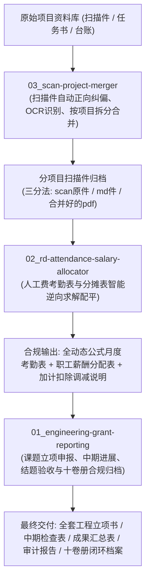

# 企业工程科技课题申报与科研财税合规 Skills 全流程套件 (Engineering R&D Suite)

> **本套件提炼自实际工程科研申报与财税加计扣除审计实战全流程，覆盖立项论证、技术排版、十卷册合规归档、人工费考勤与分摊表逆向倒推配平，以及多批次扫描件批量重组。**

---

## 📦 套件三大核心技能

```text
engineering-rd-suite/
├── 01_engineering-grant-reporting/    # 技能一：课题立项申报、十卷册审查与去AI味叙事
│   ├── SKILL.md                       # AI 调度核心技能规范
│   ├── README.md                      # 技能使用说明
│   ├── templates/                     # 6 套权威 Word 模版 + 4 套带公式 Excel 模版
│   │   ├── word/                      # 立项申报书、中期检查表、成果汇总表、验收申请、结题汇编、集团母本
│   │   └── excel/                     # 课题汇总表、RD18辅助账明细与汇总表、编制名单工时表、专利核验表
│   ├── references/                    # 十卷册核验指南、工程去AI味规范、预算勾稽准则、知识产权归属标准
│   └── scripts/                       # 自动化去AI味审查脚本、Word标准三线表批量排版模块
│
├── 02_rd-attendance-salary-allocator/ # 技能二：研发人工费考勤打卡与薪酬分摊智能生成与平衡
│   ├── SKILL.md                       # AI 调度核心技能规范（上月21-当月20周期、春节放假、领导跟随排班）
│   ├── docs/                          # SOP 标准作业规程与财务操作步骤指南
│   ├── templates/                     # 定稿打印版薪酬分配表模板 + 人工费加计扣除说明 Word 模板
│   │   ├── excel/                     # 研发人员薪酬与职工薪酬分配表模板(定稿打印版).xlsx
│   │   └── word/                      # 研发费用人工费加计扣除情况说明模板.docx
│   └── scripts/                       # 混合整数规划逆向倒推算法、多季度批量平衡引擎、尾差平账模块
│
└── 03_scan-project-merger/            # 技能三：扫描工程财税档案OCR解析、正向纠偏与按项目重组
    ├── SKILL.md                       # AI 调度核心技能规范
    ├── README.md                      # 技能使用说明与参数指引
    └── scripts/                       # 自动页面朝向校正、按课题拆分与三分法归档模块 (merge_scans.py)
```

---

## 🛠️ 三大技能在实际业务中的衔接联动



---

## 🚀 部署与使用方式

### 1. 团队与同事开箱即用（免 AI 环境）
直接解压压缩包，打开对应技能文件夹中的 `templates/` 目录，即可直接使用经财税与专家审查验证过的 Word 与 Excel 模版。

### 2. 在 AI 编码助手（Claude Code / Antigravity / Cursor / Codex）中加载
将对应的技能文件夹复制至智能体技能目录：
- **Claude Code**：放入 `.claude/skills/`
- **Antigravity / Gemini CLI**：放入 `~/.gemini/config/skills/` 或工作区 `skills/`
- 即可在日常对话中通过中文自然语言直接激活全流程能力！
